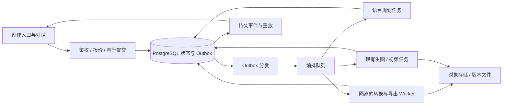

# AI 创作工作台完整实施方案

> 2026-10-25 路线纠正：剩余工作以 [Cheso 对标剩余方案](archive/cheso-alignment-remaining-plan.md) 为准。本文中以对象 JSON 作为新海报/PPT 权威源格式、继续补固定海报模板的决定已被替换：新海报采用 HTML/CSS，PPT 采用逐页完整 HTML；原对象格式只保留历史作品兼容。本文其余目标范围不缩减。

日期：2026-10-24。基线：ModelShot `435963a` 及当前工作区。状态：已开始实施，仍未完成阶段验收。当前源码、验证边界和下一步见 [实施进度](ai-creation-workbench-progress.md)。本文保留完整目标与退出条件，不以已写出的部分替代总体交付范围。

## 1. 产品目标与本次决策

以 Cheso 的创作入口、对话与作品双栏、任务过程、局部 AI 修改、文件与版本体验为完整对标，新增海报、服务端多步 Agent、PPT、文档、表格、网页六项能力。保留现有图片画布、电商套图 Agent 和已有视频生成。

产品采用“统一入口、统一对话、统一项目与产物、按类型加载编辑器”。首页“对话”改为“AI 创作”，旁边保留“电商套图 Agent”。不再另建一个与当前首页重复的入口。工程上新增 creation 领域，避免继续扩大 StudioWorkbench。

这六项都在总交付范围内；分阶段是工程顺序，不是把后面的功能从需求中删掉。视频沿用当前能力，完整时间线剪辑不在本轮新增六项内。实时多人协作、任意代码执行、全栈应用托管列为后续独立扩展，不把尚未验证的 Cheso 能力当成本轮必备功能。

页面按 Cheso 的布局、交互和信息密度高保真实现，使用来塔绘梦品牌及现有明暗主题。界面相似不要求内部实现相同：继续使用 Next/React、PostgreSQL、Redis/BullMQ、现有模型适配与账本。

### 1.1 证据边界

- Cheso：已分析公开前端、接口调用位置及一次真实视频生成。海报 HTML、VPPT 页面 HTML、Univer 文档/表格、局部 HTML 修改及文件版本有前端证据。
- Cheso 的闭源调度器、提示词、数据库和转换服务未获得。本文的后端设计是针对 ModelShot 的实施方案，不是声称恢复了 Cheso 源码。
- 本次检查了近期提交、当前入口/缓存/任务代码和本地 Next 文档，没有做新的线上性能测量。
- 下文所有性能数值是拟定验收预算；实际基线、资源配置和可承载并发必须在资源充足的环境测定。

## 2. 最近提交给出的硬约束

| 提交 | 实际改动与教训 | 新功能必须遵守 |
|---|---|---|
| `649fda6` | 降低管理查询和素材交付开销，补索引和列表缓存 | 项目列表只查元数据，不连带加载正文、历史、编辑器 |
| `1d7e51e` | 点击立即显示目标内容骨架 | 导航、任务提交、打开编辑器都先反馈，不等待网络才切屏 |
| `cb9143d` | 画布局部更新、组件缓存、上传反馈、文件哈希 Worker；同期预取曾扩大请求量 | 复用交互优化，但不恢复全站后台预取 |
| `5592b1c` | 按用户/条件/游标合并项目请求；项目保存与切换保护；图层分页并发 2 | 新列表沿用缓存失效和账号隔离；大文件不能无界并行加载 |
| `90d0d0f` | 移除 eager prefetch，管理模块本地切换，减少会话刷新 | 不在首页预加载所有编辑器；不因每次导航刷新登录态 |
| `65f3ded` | 创作模块本地切换、其他模块 lazy；首页模型目录只读 images scope | 扩展当前导航体系；能力目录按类型读取；首屏输入不等目录 |
| `680cbf4` | 修复缓存 Next 路由插槽导致首页输入框丢失 | 按路径映射真实组件，不缓存 layout children 充当页面快照 |
| `435963a` | 灵感详情首次点击、缓存预览立即呈现 | 点击一次就生效；预览缓存和真实数据校验分开 |

当前 `CreativePages.jsx` 直接导入首页，其他模块 lazy；只保留首页、灵感、项目、素材等指定页面状态。新增工作台不能把五个大型编辑器加入永久保留集合。

现有 `project-list.js` 是用户隔离的 30 秒缓存与在途合并；模型目录有独立短缓存。新接口沿用这些原则，不能让旧、新项目列表分别重复请求一份数据。

`docs/loading-performance.md` 还记录了香港到源站链路慢的现象。前端拆包只能解决一部分延迟：需要分别测 DNS/TLS/代理等待、服务端处理、传输、解码、渲染，不把“显示骨架快”当作“数据读取快”。

## 3. 页面与交互设计

### 3.1 首页

```text
                      来塔绘梦
            [ AI 创作 ] [ 电商套图 Agent ]

       ┌──────────────────────────────────┐
       │ 描述你想创作的内容，或添加参考资料…… │
       │ 附件卡片 / 已选素材                 │
       │ [添加素材] [本类型参数]   [开始创作]  │
       └──────────────────────────────────┘

 [图片创作] [海报设计] [演示文稿] [文档写作]
       [表格制作] [网页制作] [视频创作]

       我的项目   全部 / 图片 / 海报 / PPT / …
       缩略图、名称、类型、更新时间、任务状态
```

- 参考 Cheso 大输入框、下方胶囊按钮、下方项目列表的结构；首页最大内容宽度暂定 1120px，输入框 160–220px 高，移动端自适应。具体尺寸以视觉对照调整。
- 桌面按钮允许分两行，移动端自然换行，不为塞满一行而把字缩小。品牌标识复用，不额外加载大背景视频或装饰性 3D。
- 点击类型只改变本地选择、提示词范例和参数，不创建空项目、不触发生成、不加载编辑器。点击开始才创建项目/运行。
- 默认选图片，延续原习惯；每种类型分别保留输入草稿与参数。附件保留引用，切到不支持该附件的类型时提示，不静默丢弃。
- 未登录可以编辑需求，沿用现有登录流程；登录恢复时不丢稿、不自动重复提交。
- 不静默把用户选定类型改成另一个付费生成类型；需求需要多种产物时在任务计划中明确列出。
- 总体完成后显示全部七个入口；分阶段灰度时只向有资格的用户展示已完成能力，不上线可点击的假按钮。

| 类型 | 首页参数 | 工作台 |
|---|---|---|
| 图片 | 模型、比例、分辨率、数量、参考图 | 现有 `/studio-v2` 无限画布 |
| 电商 | 商品图、商品信息、风格参考、套图目标 | 现有 `/commerce` |
| 海报 | 用途、尺寸、风格、品牌、准确文案 | 对话 + 固定尺寸可编辑海报 |
| PPT | 主题、受众、页数、语言、参考资料、比例 | 对话 + 页缩略图 + 当前页 |
| 文档 | 文档类型、读者、语言、长度、参考资料 | 对话 + 正文编辑 |
| 表格 | 用途、字段/模板、数据附件、格式要求 | 对话 + 工作簿 |
| 网页 | 用途、页面数量、风格、品牌素材 | 对话 + 桌面/移动预览 |
| 视频 | 参考图、模型、比例、时长 | 接现有视频生成与播放器 |

图片价格、数量校验继续走当前提交逻辑。文档/PPT 等不显示无关的 1K/1:1 图片参数；素材生图的费用通过任务预算展示。

### 3.2 创作工作台

```text
┌ 返回  项目名       保存状态 / 任务状态     版本  导出 ┐
├───────────────────┬──────────────────────────────┤
│ 会话与真实执行步骤   │ 作品标签 / 项目文件             │
│ 需求 → 计划 → 生成   │                              │
│ 产物卡片 / 错误重试   │        当前作品编辑器          │
│                   │                              │
│ 选区引用 chip       │ PPT 可增加左侧页面缩略图         │
│ 输入修改要求 / 发送   │                              │
└───────────────────┴──────────────────────────────┘
```

- 桌面对话栏默认 360px，可在 300–480px 调整；作品区占剩余空间。窄屏以“对话 / 作品”切换，后台任务不因切换停止。
- 输入框固定在对话栏底部；任务滚动遵循用户位置，阅读历史时不被每个 token 拉回底部。
- 任务过程展示真实阶段和工具结果摘要，不展示虚构计时进度或把内部推理文本作为必需功能。
- 选中文字、海报对象、PPT 页面、单元格范围、网页区块后，输入框出现可删除的引用卡片，标明作用范围。
- 局部 AI 修改先形成候选变更；无冲突的小范围修改可自动应用并提供撤销，结构性修改提供差异预览与应用按钮。不能在后台整篇重写后假装只改了选区。
- 新产物完成后默认打开；后台更新非当前文件只显示提示，不抢走编辑焦点。
- 作品版本、保存状态和任务状态分开：生成成功不代表用户最新手工修改已保存。
- 项目文件抽屉按需加载；支持同项目多个产物和会话，为“文档转 PPT、表格转报告”预留路径。

### 3.3 明确的异常状态

每种编辑器都需要覆盖：初次加载、空白、生成中、部分完成、可编辑、待保存、保存失败、版本冲突、离线草稿、只读降级、导出中、导出失败。切页失败允许重试，不能留下永久白屏。退出时先持久化本地草稿；云端保存失败时保留恢复入口，不能无提示丢失修改。

## 4. 各能力的可交付实现

### 4.1 海报：真正生成可编辑作品

主链：提炼需求 → 确认精确文案与尺寸 → 规划版式 → 生成/选择视觉素材 → 结构化排版 → 检查 → 保存版本。

建议以 `LayoutDocument` 场景 JSON 为权威源，含画板、稳定对象 ID、文本、图像引用、形状、位置、层级、字体、颜色、约束、锁定状态和语义角色。渲染结果可为 Canvas/SVG/受控 HTML，但不同时维护几个互相冲突的权威正文。

- 图片模型生成背景、商品辅助场景和插画；标题、日期、价格等应为真实文字对象。复杂艺术字可栅格化，但必须在对象属性里标明不可直接改字。
- 首版支持拖拽、缩放、文字编辑、对齐、层级、锁定、撤销重做、替换图片、字体及颜色、画板尺寸。
- 复用现有 Konva 选择/变换/图片显示等基础组件，不把新海报挂到整个 StudioWorkbench 的状态树里。
- 修改“日期改 11 月 1 日，标题放大，其他不动”必须输出针对日期/标题对象的 patch；未修改对象的内容与资产引用保持不变。
- 检查文字溢出、缺图、缺字体、对比度、边界裁切、准确价格/日期。检查可以结合确定性规则和有上限的模型复核，不无限自动修稿。
- 导出 PNG/JPEG/PDF；支持范围内提供 SVG。PSD 原生文字保真不纳入首轮承诺；不能把栅格化图层称为完整可编辑 PSD。

Cheso 使用 HTML 海报；此处选场景文档是为了利用已有画布能力、确保对象级修改，并服务后续 PPT 原生导出。视觉效果和交互应对标 Cheso，模板需涵盖促销、活动、品牌、信息长图，不能只提供三种固定版式。

### 4.2 PPT：大纲、多页编辑、真实 PPTX

主链：读取资料 → 生成大纲 → 用户可编辑大纲 → 确认页数与预算 → 逐页内容与布局 → 素材 → 校验 → 演示与导出。

- 幻灯片复用海报的基础布局节点，增加页 ID、标题、大纲关联、备注、主题、母版和图表/表格节点。
- 页缩略图、增删、复制、重排、隐藏、单页重做、局部改字、主题替换、全屏演示是首个完整版本的必备能力。
- AI 先生成内容结构，再做页面排版；可先看到大纲和已完成的页面，无需等全套结束。
- 导出原生 PPTX：优先将文本、形状、图片、表格、支持的图表转换为 OOXML 对象；拟评估 PptxGenJS，版本/许可证/能力在技术验证阶段锁定。
- 高级视觉效果允许局部图片化，但导出前提示哪些对象失去可编辑性。不能全页截图塞进 PPTX 后声称原生可编辑。
- PDF 使用统一字体和固定画板渲染。PPTX 在 PowerPoint/WPS 至少各一套环境验证换行、字体、图表、表格和页面尺寸。
- 外部 PPTX 导入与自产 PPTX 导出分开验收：首版提供解析/预览与支持对象编辑；复杂 SmartArt、动画、公式等原文件保留并明确降级。高保真任意 PPTX 编辑是后续兼容性阶段，不隐含在简单导出中。

### 4.3 文档：写作、选区修改、DOCX 往返

主链：整理资料 → 大纲 → 分节生成 → 引用/数字核对 → 结构化文档 → 手工与 AI 编辑 → 导出。

- 支持标题、段落、列表、表格、图片、链接、分页、基础页眉页脚；提供续写、缩写、改写、翻译及选择段落修改。
- 首选验证 Univer Docs 的编辑和分页能力，与表格栈保持一致。若其目标版本能力或许可不满足，采用基于 ProseMirror 的块编辑器作为替代；选择在 P0 结束前固定，不能在开发中长期维护两套编辑器。
- 原生文档保存为带稳定 block ID 的编辑器文档；维护标准化语义块适配层，AI 只提交受验证的 block 操作。
- DOCX 导出拟评估 `docx`；PDF 在转换 Worker 中渲染；Markdown 导出明确不保留分页和部分排版。
- DOCX 导入保留原始二进制及格式检查报告。基础文档可编辑；复杂修订、域、脚注、公式等不得悄悄丢失。高保真往返以原 OOXML 保留与定向回写实现，无法安全保存时保留原件、提供另存简化副本。
- 对长文分节加载/编辑；不把几十页文字每个 token 都序列化一遍。参考资料引用记录文件版本和页/段位置，不虚构来源。

### 4.4 表格：可计算、可修改、可验证

主链：解析数据/需求 → 工作表设计 → 写入数据与格式 → 生成公式 → 实际回算 → 校验 → 保存工作簿。

- 首选验证 Univer Sheets，配合 ExcelJS 负责支持范围内 XLSX 解析/导出；CSV 使用成熟解析器处理引号、换行、编码和分隔符。
- 支持多工作表、单元格编辑、基础样式、排序筛选、冻结、常用公式、范围选中后 AI 修改。基础图表在公式数据可靠后接入。
- AI 操作使用明确的工作表 ID、范围、单元格值/公式和样式 patch；禁止让模型生成脚本直接操作浏览器宿主。
- 区分数据、公式和显示值；公式必须由计算引擎回算。验证 SUM/IF/查找/跨表引用等选定集合；不支持函数不能静默显示过期缓存结果。
- 给出循环引用、除零、引用失效、重算超时提示。禁止自动执行宏或访问外部数据连接。
- XLSX 导入保留原 ZIP；针对透视表、外部链接、图表等建立兼容能力表和无损回写规则。未支持内容只读或另存，不能经一次保存后被悄悄清空。
- 首版交互预算：不超过 5 个工作表、10 万个非空单元格的标准样本；公式密度另设上限。大于预算先做后台解析/只读分段预览，不能让浏览器卡死。该值是待验证上限，不等于承诺任意 10 万公式都流畅。
- CSV 导出提供防公式注入的文本模式；真实公式需要 XLSX 明确表达，不把用户文本意外变成可执行公式。

### 4.5 网页：生成、区块修改、响应式预览、发布

主链：需求 → 页面结构/设计主题 → 生成 HTML/CSS/受限 JS → 资源处理 → 浏览器校验 → 预览 → 修改 → 导出/发布。

- 本轮完整交付静态品牌页、活动页、产品页、多页展示站；包括桌面/移动视口、区块选中、文字/样式修改、源码查看、版本、ZIP 下载和静态发布。
- 以网页文件树为权威源，元素有稳定 ID；结构化修改通过解析后 patch 回文件。预览只是派生产物，不能从运行后 DOM 随意反向覆盖源码。
- 预览使用独立 origin 的 sandbox iframe，校验消息 origin/source/schema。生成内容不得获得主站 Cookie、任意主站 API 权限。
- 资源引用使用版本化资产；默认禁止任意外链脚本和任意网络访问，按能力显式开放。发布前进行链接/资源/移动溢出检查。
- 发布为用户主动动作：上传不可变版本到静态存储，更新发布指针；支持撤回与回滚。预览成功不自动公开发布。站点密钥和模型凭据绝不进入 HTML。
- 表单初期支持展示或明确接入已有受控提交服务，不生成假成功反馈。数据库、登录系统、支付、电商后端、任意 npm 项目构建不在静态网页能力内。
- Cheso 完整部署后台尚未确认；若要进一步做全栈网站生成，需要另设受限执行环境、构建队列、域名/证书和运行资源治理，不放入现有 Next Web 进程。

### 4.6 跨类型能力

全部模块稳定后接入：文档转 PPT、表格转报告、PPT 页转海报、海报视觉转网页。应创建新产物并记录来源版本；转换是新的语义任务，和文件格式导出分别计费、分别追踪，不能覆盖原件。

## 5. 前端工程结构

建议新增以下边界，具体文件在实施时按现有 JS/JSX 风格落地，不为本功能先做全仓 TypeScript 迁移：

```text
src/components/creation/
  CreationWorkspace.jsx       # 轻量外壳、布局和生命周期
  CreationConversation.jsx    # 分页消息、选区引用、输入框
  RunTimeline.jsx             # 真实阶段事件
  ArtifactHost.jsx            # 只挂载当前产物编辑器
  ArtifactToolbar.jsx         # 保存、版本、导出
  ProjectFiles.jsx            # 按需打开的文件面板
  editors/{poster,slides,document,sheet,web}/
src/lib/creation/
  kinds.js                    # 纯元数据，无编辑器静态 import
  contracts/                  # 文档、操作、事件 schema
  client/                     # 会话、任务、文件缓存与订阅
src/lib/domain/creation/
  runs.js / scheduler.js / tools.js / artifacts.js
  events.js / revisions.js / quotes.js / recovery.js
src/app/api/creation/          # 薄路由，调用领域服务
src/workers/creation-*.mjs     # 编排与转换独立入口
```

- 新工作台路由建议 `/{locale}/create?project=...&session=...&artifact=...`，纳入现有本地导航映射；刷新直达仍有 Next 页面和服务端鉴权。仅切换文件参数不重建整个会话。
- 首页保留直接导入，仅加入轻量类型按钮和 composer 参数分派。图片和电商继续走现有路由。
- 工作台、对话、编辑器、工具弹层分层拆包；编辑器 loader 使用显式静态路径，不在 barrel 文件中导出所有重模块。
- 编辑器统一接口：`load / applyOperations / getSelection / flush / getCapabilities / dispose`。导出交给后台，不要求每个编辑器都加载 OOXML 导出器。
- 状态按会话、任务、产物、选区、视口分开订阅。聊天 token 更新不能重绘画布；拖动对象不能重绘完整聊天历史。
- 当前重编辑器最多一个，PPT 编辑画布最多一个；切走前保存草稿，卸载编辑器、观察器、iframe、Worker 和 Blob URL。JS 模块缓存无需强行清除，重点释放实例和大数据。
- 快照和撤销历史有界，操作级 undo 优先，不为每次鼠标移动保存整份文档。
- 当前 Next 本地文档确认 lazy/dynamic 及原生 History API 集成可用；`ssr:false` 只在 Client Component 中配置。实施后需用构建产物证实实际拆包，不能仅看写了 dynamic 就认为隔离成功。

## 6. 后端多步 Agent：先持久化，后执行

### 6.1 总体链路



现有单个图片任务已有持久执行、租约/fence、预留结算和对账，继续复用。当前 `StudioWorkbench.runPlan` 在浏览器依次提交后续步骤；新系统让浏览器只提交一次 Run，后续步骤在服务端推进。现有同步 `billedLanguageCall` 不能直接当成可恢复的后台规划器，需增加持久语言任务适配并保留账本语义。

### 6.2 执行流程

1. 按用户、项目权限校验输入、附件和预算，使用 requestId + inputDigest 防止重复请求变成重复任务。
2. 事务写入 Run、初始 Step、预算授权与 Outbox，返回 202；HTTP 不等待 LLM 规划或文件生成。
3. 规划也是一个可追踪步骤：生成受 schema 约束的 DAG，校验工具白名单、依赖、输入上限、循环、资源和费用后持久化。
4. 调度器短租约领取就绪步骤并写子任务 Outbox，立即结束当前调度作业；不能占用一个 Worker 槽位等待整条计划。
5. 各执行器分别进行 LLM、图片、解析、排版、导出。供应商长任务存 jobId，并由延迟查询任务恢复，不靠 HTTP 长连接存活。
6. 步骤结果提交时以 fence/CAS 校验归属，事务写结果引用、步骤状态、结算记录与事件/后续调度 Outbox。
7. 依赖满足的后续步骤自动推进。可并行的素材任务受预算和并发限制；同文件编辑串行或通过版本比较合并。
8. 生成结果成为新版本。若用户已修改当前文件，保存为候选分支/候选修订，不覆盖用户更新。
9. 终态写最终摘要、产物和已用费用，释放未使用的预留；客户端退出不改变 Run 执行。

### 6.3 状态与恢复

Run：`queued → planning → running → succeeded / partially_succeeded / failed`；另外包含 `awaiting_input / awaiting_budget / cancelling / cancelled / reconciling`。

Step：`blocked → ready → queued → running → succeeded`，以及 `retry_wait / failed / skipped / cancelled / reconciling`。Run 与 Step 各自有明确终态和允许转换，不能用“进度 100%”代替完成判定。

- 恢复以数据库状态为准；BullMQ 至少一次投递，业务副作用靠幂等，不宣称外部模型调用天然 exactly-once。
- 超时且供应商支持查询：进入对账；有 requestId 的异步任务不重复提交。同步调用结果未知时，不自动盲重试付费生成。
- 用户重试失败步骤复用已成功依赖；输入变化则创建新尝试/运行并保留关系，不把不同输入塞进同一个幂等键。
- 取消后禁止调度新步骤，向可取消供应商发取消；已完成或不可取消的调用按真实结果结算。迟到结果可以归档，但不能继续推进取消运行。
- Worker 崩溃后租约过期恢复；同一步不允许旧 worker 的迟到结果覆盖新尝试。完成事件丢失由周期恢复扫描补推进。
- 同一文件 AI 变更和手工保存都走 baseRevision 校验。PPT 不同页可合并不冲突的操作；全局主题修改与页面修改存在冲突时需显式解决。
- 初期建议单 Run 默认最多 24 步、最大 64 步、规划修正最多 2 轮；超限等待用户调整，不无限自主扩展。

### 6.4 计费

创建任务给出估算与预算上限；规划可能发现额外素材费用，超出授权预算时等待确认，不偷偷继续。为避免双扣，Plan 预算只记录授权/已占用额度，不在原任务积分预留之外再次预留一份相同费用；每个付费步骤继续使用现有 ledger/reservation 事务。

用每 Run 的预算锁与每用户账本锁防止并行步骤超支。需要明确“积分不足时部分结果保留、哪些步骤未执行、如何继续”。人工编辑不调用模型；自动保存不消耗生成积分。价格变化、估算、实际消费、失败释放与部分成功要在界面和账务明细一致。

## 7. 数据模型、文件与接口

### 7.1 建议新增模型

| 模型 | 关键内容与约束 |
|---|---|
| CreationProject | userId、title、kind、cover、updatedAt、deletedAt；按用户/删除标志/更新时间/id 分页索引 |
| CreationSession / Message | 项目、消息序号、角色、正文、引用；按 session/sequence 游标分页 |
| CreationRun | requestId、digest、status、budget、cost、planVersion、取消标记；用户+requestId 唯一 |
| CreationStep / Attempt | DAG 依赖、tool、输入快照、状态、lease、fence、providerJobId、结果引用；run+stepKey 唯一 |
| CreationEvent | runId、单调 seq、type、紧凑 payload、createdAt；runId+seq 唯一 |
| CreationArtifact | 项目、类型、名称、currentRevision、预览引用、schemaVersion |
| ArtifactRevision | artifactId、revision、baseRevision、对象存储引用、hash、来源 run/step；版本唯一 |
| ArtifactOperation | 保存键、baseRevision、受限操作、操作者；用于幂等和冲突识别 |
| ArtifactReference | 对 Asset/源文件版本的引用，供权限、导出和垃圾回收 |
| ArtifactExport | 固定输入版本、格式、状态、结果引用、导出器版本；输入指纹去重 |

最终表名以 schema 设计为准。不要为设计图中每个框建立独立微服务。现有 Outbox/Asset/积分账本保持为共享基础，不复制一套。

正文与元数据分开：数据库保存查询所需状态、版本和紧凑操作；大型页面正文、原始 DOCX/XLSX、预览和导出放私有对象存储。PPT 按页、网页按文件、长文按节引用，工作簿按引擎能力分块/快照。不能把整个工作簿 JSON 塞进列表或 SSE。

存储与数据库不是一个事务：上传到 staging key → 校验大小/hash/格式 → 数据库提交版本及引用 → 延迟清理未引用 staging。提交失败的对象不能成为“当前版本”；没有数据库引用且过安全保留期的对象才回收。

### 7.2 旧项目兼容

- `StudioDocument` 继续保存现有画布/电商数据，不批量改写所有旧 content。
- 统一项目库通过轻量索引关联新项目与旧文档：按需建立 legacy link，或后台小批回填索引，不迁移正文。
- 列表统一分页和排序，避免每页全量取两类数据后在浏览器拼接。旧 id/链接保持可打开，旧保存 API 继续有效。
- 新海报生成图片可导入旧画布；结构化对象只有在支持对应节点时转换，不能导入后无声失去含义。
- 将旧画布多步计划迁入新执行器分批灰度；旧在途任务由原链路处理完，避免双调度。电商策划和商品一致性约束通过专用工具适配保留。

### 7.3 API 草案（拟新增，不是 Cheso 原接口）

| 接口 | 行为 |
|---|---|
| `GET /api/creation/capabilities?kind=` | 当前类型的可用能力及价格版本；不串行探测所有供应商 |
| `POST /api/creation/projects` | 幂等建项目；返回轻量元数据 |
| `GET /api/creation/projects?cursor=&kind=` | 分页元数据；与旧项目索引统一 |
| `POST /api/creation/runs` | 输入、引用、类型、requestId、预算授权；返回 202 + runId |
| `GET /api/creation/runs/:id` | 当前快照与事件游标 |
| `GET /api/creation/runs/:id/events?after=` | SSE、seq 去重、断线续读；权限独立校验 |
| `POST /api/creation/runs/:id/cancel` | 幂等取消请求 |
| `POST /api/creation/runs/:id/resume` | 回答澄清/补预算后继续；并发与版本校验 |
| `POST /api/creation/runs/:id/retry` | 明确范围与新尝试；失败步骤恢复 |
| `GET /api/creation/artifacts/:id` | 元数据、当前版本及按需正文引用 |
| `POST /api/creation/artifacts/:id/operations` | baseRevision、saveKey、受 schema 限制的修改 |
| `GET /api/creation/artifacts/:id/revisions` | 游标分页版本摘要 |
| `POST /api/creation/artifacts/:id/restore` | 从历史生成新版本，不删除后续历史 |
| `POST /api/creation/artifacts/:id/exports` | 固定版本异步导出；返回 exportId |
| `POST /api/creation/artifacts/:id/publish` | 静态网页显式发布，权限与配额校验 |

附件沿用 Asset 归属与直传机制，但需新增通用文档 MIME/大小/解压上限；不能把图片上传接口改成无限制文件入口。所有查询过滤 userId/project 权限，所有缓存包含身份；生成网页不能绕过权限调用这些 API。

### 7.4 局部修改示例契约

以下是说明性数据，不是已实现代码：

```json
{
  "artifactId": "poster_1",
  "baseRevision": 7,
  "saveKey": "unique-client-operation-id",
  "operations": [
    { "op": "setText", "nodeId": "opening_date", "text": "11 月 1 日" },
    { "op": "setStyle", "nodeId": "headline", "style": { "fontSize": 72 } }
  ]
}
```

服务器按类型校验 nodeId、可编辑字段、尺寸/文本上限和 baseRevision；操作作用于当前快照并生成新修订。未授权路径、未知操作、越界范围直接拒绝。不能接收任意 JavaScript 或无约束 JSON Patch 修改内部权限字段。

## 8. 性能设计与发布门槛

### 8.1 前端预算

统一基准环境、数据、浏览器版本、冷/热缓存、网络与 CPU 配置；分别记录中位数、p95 和 RUM p75。以下预算用于立项，不是当前测量结果。

| 指标 | 初始目标 / 门槛 |
|---|---|
| 首页新增传输 JS | gzip 增量 ≤ 30KB；不含任一新编辑器/OOXML/导出依赖 |
| 新工作台公共壳 | 首轮新增 gzip JS 暂定 ≤ 100KB，不含当前类型编辑器；超限需拆包或评估 |
| 首页业务请求 | 新创作模块在未选用时新增请求 0；不查询六类能力，不预取所有工作台 |
| 类型选择、导航首次反馈 | 已挂载场景 p95 ≤ 100ms；此指标不代替编辑器可用时间 |
| 打字/选择/普通拖拽响应 | 标准样本 p95 ≤ 100ms；字段 INP p75 目标 ≤ 200ms |
| 首页 LCP / CLS | 同条件不回退超过 10%；争取 p75 LCP ≤ 2.5s，CLS ≤ 0.1，既有不达标另列问题 |
| 项目列表 | 每页 24 条、元数据响应原始 JSON 暂定 ≤ 50KB；不包含正文/base64 |
| 冷打开新编辑器 | 标准桌面、约定网络下 p95 ≤ 3s 可交互；移动 ≤ 5s；同时记录下载/初始化分项 |
| 常规编辑主线程 | 高频事件不执行 >50ms 同步任务；解析/压缩/重算分片或移至 Worker |
| 已加载作品切页 | PPT 当前页切换 p95 ≤ 150ms；仅当前页可编辑，缩略图虚拟化 |
| 消息与事件 | 消息游标分页；文本批次 50–100ms 合并，不能每 token 全树重绘 |
| 内存 | 标准桌面样本新编辑器 JS heap 软预算：海报/PPT ≤200MB，文档≤180MB，表格≤250MB；移动另测更低配额 |
| 反复切换泄漏 | 20 次往返后，受控 GC 的保留堆增量目标 ≤20MB 且无持续上升；不以操作系统 RSS 必须立即下降判断泄漏 |

打开 XLSX、PPTX 的压缩包大小不是内存上限。还要限制 ZIP 解压总量、条目数、图片解码像素、非空单元格和公式依赖数；超限转后台或拒绝重操作并给出替代路径。

### 8.2 高频操作的具体处理

- 海报拖拽在编辑器内部更新位置，拖拽结束再提交操作；不在 pointermove 上写数据库或 stringify 文档。
- 文本编辑暂停 800–1500ms 后合并保存，最长约 5 秒做一次增量提交；发送 AI 修改/导出前显式 flush 到确定版本。具体间隔用体验测试校准。
- 本地草稿使用 IndexedDB、按产物/账号隔离、写入合并和容量上限；不能把整个工作簿写 localStorage。页面关闭事件不保证异步完成，因此持续保存而非只靠 beforeunload。
- PPT 缩略图按需渲染、并发初始 1–2、只刷新改动页；30 页不创建 30 个完整编辑器或运行 iframe。
- 文档优先编辑引擎自己的增量事务；只有验证支持时使用分页虚拟化，不能以破坏输入法、选区为代价强行卸载正文。
- 表格虚拟行列，计算引擎避免全表重算；如目标库不支持 Worker 计算，必须验证分片能力或缩小可编辑上限，不宣称“包个 Worker 就解决”。
- 图片继续用 320/640/1280 预览与明确放大条件，导出才取原图。字体只加载当前文档用到的集合，不下载完整字体市场。
- 隐藏页面停新增读取、观察器与动画；当前产物切换用取消令牌拒绝旧响应回填。任务继续由服务器运行。

### 8.3 事件与数据库负载

不能为每个步骤复制现有 `createJobStream` 每 2 秒查库一次的模式：100 个连接若每个轮询一次就约 50 次读取/秒，还不含其他请求。

- 关键状态、步骤结果、产物版本使用持久事件；Redis Pub/Sub 只作唤醒，不作为唯一事件存储。
- 每个 Web 实例复用 Redis 订阅连接，以 runId 分发给本机客户端；同 run 的多个订阅者合并读取。数据库有 `(runId, seq)` 索引，返回有界批次。
- 先注册通知、读取 afterSeq 之后的事件，再追到水位，结合 seq 去重解决订阅/回放间隙；通知丢失通过低频共享水位核对补齐。
- 心跳只维持连接，不每次心跳查业务全表。SSE 一次对应当前可见运行，不按每个 Step 开连接；健康 SSE 不同时跑轮询。
- 断线使用指数退避和抖动，例如 2/4/8/16/30 秒；完成后关闭。后台标签不持续订阅大量运行，回来按游标补齐。
- token 可以批次推送，重要里程碑可靠持久化；正文按块/阶段落盘，不为每个 token 建一行数据库记录。
- 回放最多返回有界窗口；事件保留期初定 30 天，旧游标返回新快照和水位。最终消息与文件版本按项目保留策略管理，不依赖无限事件日志。
- SSE 代理关闭缓冲并设置合理超时；同源 HTTP/2、多标签连接上限及部署连接容量单独验证。

### 8.4 资源隔离：不能只靠拆包

现有模型执行默认并发配置代码可达 128；这是远端模型调用的并发，不是允许 128 个 Chromium/LibreOffice 进程。生产有效配置此次未读取，不能根据默认值断言线上配置。

新增任务分类：

| 类型 | 运行方式 | 初始限制建议 |
|---|---|---|
| 编排推进 | 轻量短任务，独立队列 | 有界并发，不等待子步骤完成 |
| LLM 规划/编辑 | I/O 工作队列 | 初始全局 2–4，每用户 1 个活跃 Run，按实测调整 |
| 图片/视频 | 复用现有生成队列及供应商限额 | 每 Run 初始最多 2 个素材请求；不放大现有全局上限 |
| 解析/预览/导出 | 独立进程/容器，专用队列 | 每实例初始并发 1，超时/内存/CPU/临时磁盘配额 |
| 静态发布/资源传输 | I/O 队列 | 有界并发，与模型/转换隔离 |

独立队列不等于资源隔离。Chromium、Office 转换和大型 ZIP 解析必须在独立受限容器或独立机器运行。若小服务器无法给 Web/数据库/Redis 留出稳定资源余量，重型转换使用另一台 Worker；这是正式开放 PPT/Office 导出的部署前提。不能把它们放进 Next API handler，也不能无限启动进程。

现有通用 worker 还处理支付、退款等任务，新转换不得挤占其槽位。全局与用户队列设容量、截止时间和排队提示；达到容量拒绝新增或延迟准入，不靠无限积压实现“看似都提交成功”。

内容哈希 + 版本 + 导出器/字体版本作为派生预览缓存键；只缓存已完成结果。缩略图异步生成，首次打开优先显示已有封面，不同步渲染整个文档。

### 8.5 后端目标与观测

- 标准负载下，纯元数据 API 的服务端执行 p95 目标 ≤300ms，Run 准入 ≤500ms；不含网络、模型推理与文件上传。
- 旧首页/项目/画布 API 在新任务压力下 p95 相对基线回退不得超过 10%；错误率增加不超过 0.1 个百分点，并单独检查小样本统计有效性。
- Web 容器 event-loop delay p95 目标 <50ms；内存应稳定在配置额度内且保留至少约 25% 余量。具体 DB 连接数由总连接预算分配，不让每个新 Worker 使用默认大连接池。
- 每 Run 记录排队、规划、工具、素材、排版、校验、导出时间，以及实际模型费用、重试和对账次数。模型耗时不并入 UI 响应 SLO，但仍需显示超时与阶段状态。
- Server-Timing 分开 auth/query/serialize，RUM 分开 network/editor-init/render；日志只含必要 ID/阶段/耗时，不记录凭据或整份用户资料。
- 观察 Redis 连接、待处理队列长度/年龄、Outbox 滞后、DB 慢查询与锁、对象存储失败、Worker OOM。任一重任务导致 Web 资源持续饱和时停止扩大灰度。

### 8.6 标准性能样本

P0 固定样本与环境：旧画布 100 图层、旧电商 10 张卡片、海报 100 对象、PPT 30 页、文档 50 页、表格 10 万非空单元格（分别测低/高公式密度）、网页 5 页，另加一个明显超限样本验证降级。

旧入口回归路线：首页输入→灵感→首页，项目→旧画布→编辑→保存→返回，电商规划→生成→切页→恢复，上传→预览→导出。所有阶段复测这些路线，不能只测新页面。

负载按 1/5/10 个活跃创作用户逐级增加，停止点由资源与延迟门槛决定；这些档位不是服务器容量承诺。真实供应商调用采用明确预算的小样本；重复性能测试使用可控 provider fixture，不靠大量付费生图压测。

## 9. 实施顺序与每阶段退出条件

| 阶段 | 交付内容 | 进入下一阶段的条件 |
|---|---|---|
| P0 基线与技术验证 | 性能基线；首页/工作台视觉稿；Univer、PPTX 导出、中文字体、隔离转换小样；依赖许可核验 | 编辑/导出技术选型冻结；明确标准样本、预算和部署资源 |
| P1 统一入口与任务底座 | AI 创作首页、公共工作台、项目/文件/版本、Run/Step/事件/恢复/预算；接现有图片工具 | 关闭页面整条任务继续；重复提交不双扣；旧流程不回退；底座先内部使用 |
| P2 海报闭环 | 结构化海报、素材、局部 AI 修改、手工编辑、版本和 PNG/PDF 导出 | 日期/价格精准修改；未选对象不变；版式检查；性能达标后首轮灰度 |
| P3 PPT | 大纲、页面编辑、单页修改、演示、PPTX/PDF；导出队列 | 中文真实 PPTX 可编辑、演示正常；30 页样本与旧功能压力回归通过 |
| P4 文档 | 文档生成、选区修改、分页、DOCX/PDF/MD；基础导入 | 长文流畅；基础 DOCX 往返；复杂格式有明确保护和另存路径 |
| P5 表格 | XLSX/CSV、多表、范围 AI 修改、公式回算、导出 | 公式实算正确；单元格修改不丢其他部件；大表与超限样本通过 |
| P6 网页 | 页面生成、区块修改、隔离预览、响应式、ZIP、静态发布/回滚 | 预览与主站隔离；资源完整；发布版本可追踪回滚 |
| P7 完整对标与兼容增强 | 跨格式任务、Office 复杂样本、全链路观测、灰度扩大 | 六项功能能力矩阵验收；旧站性能与资金恢复验收；未支持项准确标注 |

P3–P6 都是当前总体需求，不能在完成海报后宣布整个项目完成。网页底层可复用布局/预览，但独立发布与隔离能力仍需专门验收。真实项目排期应在 P0 验证后给出；不在未验证 Office 兼容性和服务器容量前承诺几天完整复刻。

## 10. 验收案例与验证环境

| 能力 | 必须通过的代表用例 |
|---|---|
| 海报 | 咖啡店开业海报；只改日期和标题字号；背景资产 hash 不变；撤销与导出一致 |
| Agent | 生成素材→排版→导出中关闭页面、重启 Worker、重复消息、断线重连；后续继续且无重复扣费 |
| PPT | 从参考文档生成 15 页；修改第 3 页、重排第 5 页；备注随 pageId；PPTX 在目标软件可编辑 |
| 文档 | 20 页报告改一个段落；其他章节不改；中文标题/列表/表格/页眉页脚导出；原始附件保留 |
| 表格 | 销售明细→月度统计→公式合计；修改源数据后重算；导出再打开结果一致；不支持函数明确报错 |
| 网页 | 产品活动页桌面/移动布局；只改 CTA；下载 ZIP 可用；发布/回滚；预览无法访问主站会话 |
| 版本 | AI 运行中手工修改；迟到结果不覆盖；恢复历史生成新版本；导出固定版本不混入后续修改 |
| 资源与权限 | 跨账号缓存清理、附件归属、无权文件访问拒绝、超大解压/图片像素/公式超限有界处理 |
| 性能 | 新任务并发运行时旧首页/画布/电商仍满足基线门槛；反复切页无无界内存增长 |

验证分层：本机只做允许的限定静态检查；CI 做 schema/幂等/状态迁移/账务/导出语义和必要 UI 回归；资源充足的预发环境做真实浏览器、导出渲染与压力测试。每阶段只增加与风险相匹配的测试，避免为了覆盖率重复实现逻辑。

遵守仓库 AGENTS：本次方案阶段不运行构建、测试套件、安装或开发服务。后续性能报告需带基线 commit、测试数据、硬件、网络、冷/热缓存、样本数和结果，不能只给“感觉更快”或某次截图。

## 11. 灰度、迁移与回滚

- 功能开关拆成入口、各编辑器、后台调度、格式导出、网页发布；不能只用一个总开关让所有模块同时上线。
- 数据库采用新增表/字段/索引的兼容迁移；大索引与回填需评估锁与批次，不在请求里做全量迁移。
- 旧任务先完成，新的运行按版本路由。回滚前端入口不等于删除任务；保留匹配版本 Worker 继续处理在途工作。
- schemaVersion、toolVersion、exporterVersion 写入快照，旧文件可打开，新功能停用后仍能下载已生成作品。
- 开关关闭禁止新建相关运行，已有作品保留只读/导出路径。错误任务可暂停推进，已经开始的付费调用按原对账策略结算。
- 灰度先内部账号，再小比例用户，最后全量。每个阶段核对旧路由延迟、错误率、费用准确性和队列资源；触发回退门槛就关闭新增准入，保留恢复处理。

## 12. 需要在 P0 消除的具体不确定性

1. 当前生产机器配置、有效生成并发、DB 连接预算、Redis 配额及代理超时：这次未读取生产配置，不将代码默认值当实际容量。
2. Univer Docs/Sheets 目标版本对 React 19、浏览器、公式、分页与导出适配的实际支持；哪些能力属额外许可，需要在选型时确认。
3. 原生 PPTX、DOCX 与 Office 往返的支持对象范围；不能把 Cheso 前端有导出按钮当作我们转换器已可用。
4. 中文字体供应、许可、字体下载量、浏览器与导出端一致性，以及复杂排版的保真降级规则。
5. 香港静态资源、API 回源和对象存储线路的实际耗时；新增包/字体发布沿用现有本地静态交付机制并验证命中。
6. 预览独立域名、转换 Worker 的部署资源以及静态网页发布存储；这些影响真正开放能力的时间。

这些问题通过技术小样和基线测量解决，不要求用户先回答全部技术细节，也不影响先交付本方案。

## 13. 代码与研究依据

- [近期加载与性能记录](loading-performance.md)
- [首页入口](../src/components/discover/DiscoverHome.jsx)
- [本地导航与模块挂载](../src/components/discover/CreativePages.jsx)
- [共享项目请求](../src/lib/studio/project-list.js)
- [旧画布计划与交互](../src/components/studio/StudioWorkbench.jsx)
- [旧项目保存恢复](../src/components/studio/useStudioProject.js)
- [旧任务订阅](../src/components/studio/useStudioJobs.js)
- [服务端现有事件流](../src/lib/domain/studio/job-stream.js)
- [模型作业提交](../src/lib/domain/studio/jobs.js)
- [语言调用现状](../src/lib/domain/studio/language.js)
- [现有执行与账务衔接](../src/lib/domain/generation/execution.js)
- [Outbox 与队列](../src/lib/infra/queue/index.js)
- [现有 Worker](../src/workers/main.mjs)
- [并发配置默认值](../src/lib/infra/execution-config.js)
- [数据模型](../prisma/schema.prisma)
- [Cheso 与 ModelShot 对比](../../rea/investigations/cheso-2026-10-24/MODELSHOT-COMPARISON.md)
- [Cheso 完整逆向报告](../../rea/investigations/cheso-2026-10-24/REPORT.md)
- [Cheso 编辑器与文件证据](../../rea/investigations/cheso-2026-10-24/chapters/04-editors-assets-collaboration.md)

最初方案阶段只产出设计文档；后续已获授权开始修改业务源码。数据库迁移、运行验收、部署与完整交付状态以 [实施进度](ai-creation-workbench-progress.md) 中的证据为准。
