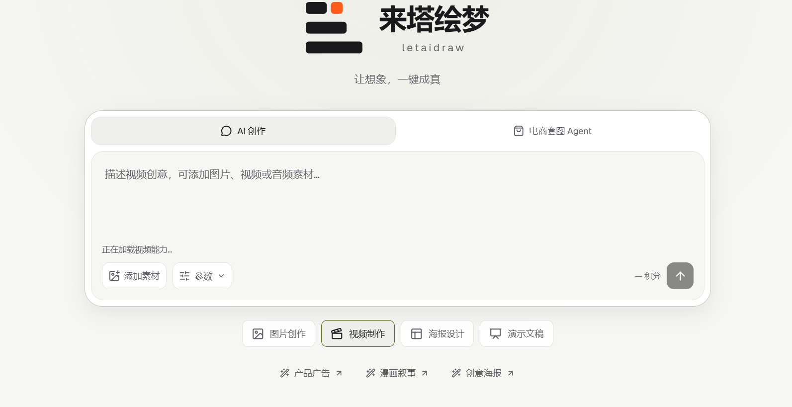

# ModelShot 图片与视频升级方案：以即梦为对标基准

版本：V1.1 · 2026-11-11
状态：用户已授权按本文开发并最终 push；开发进行中，尚未完成部署或真实模型效果验收。
代码观察基线：`4b64f3b`，结合当前工作区源码。
范围：图片创作与编辑、自由画布内视频、首页「视频制作」Tab 及其独立视频工作台。

## 1. 升级目标与完成定义

本次以即梦为图片、视频创作体验的对标基准，统一 ModelShot 三个使用位置的素材、参数、任务和结果操作。不能只改首页外观、只接通一个供应商，或只升级独立视频页面，就宣布完成。

用户应能连续完成：

> 上传图片与参考素材 → 生成／修改图片 → 在画布上把图片生成视频 → 播放并继续修改视频 → 到视频工作台编排 → 保存、下载或回到原画布。

同时支持从首页「视频制作」直接开始文生视频、首尾帧或多模态参考创作。两条路径采用相同的模型能力、参数校验、报价和任务规则。

**“严格参考即梦”分为三个独立验收维度：**

1. **界面效果**：有即梦截图或录屏依据的布局、控件层级、素材展示、弹层、状态反馈逐项对照；保留本站品牌和导航。不能用主观“类似”代替对照验收。
2. **操作效果**：素材如何引用、参数如何联动、任务如何恢复、作品如何继续创作，以已核实的即梦流程为基准。
3. **生成效果**：主体一致性、文字准确性、运动和时序质量需要同条件样本验证。使用已授权供应商服务，不能将客户端反编译视为获得了即梦的模型、权重或服务端能力。

当前证据不足以承诺像素级复刻即梦全部界面，也不足以承诺输出质量完全相同。此文档明确升级范围；视觉规格在第一阶段补齐证据后冻结，不能将未核实部分自行设计后称为“严格对齐”。

## 2. 参考资料与证据等级

| 等级 | 资料 | 可支持的结论 | 不可支持的结论 |
| --- | --- | --- | --- |
| A：当前截图 | 用户提供的两张本站截图，见下方 | 当前入口、布局、加载提示、视频按钮灰态 | 灰态或加载状态的运行时根因；即梦长什么样 |
| B：当前代码 | 本项目图片、画布、视频组件及任务服务 | 已实现路径、数据限制、入口之间的差异 | 线上配置正确、每个模型已通过实测 |
| C：即梦静态证据 | Android `com.bytedance.dreamina` 2.4.0 的已提取客户端 | 图片／视频请求结构、素材处理、任务提交和查询等 | 当前网页版行为、完整界面尺寸、线上功能开关、生成质量 |
| D：待采集 | 即梦目标版本的截图、操作录屏与同条件生成样本 | 后续视觉和效果验收依据 | 采集前不得当成已验证事实 |

本轮对标限定来源为即梦。历史文档中的椒图、Cheso 等仅用于理解 ModelShot 已有实现，不作为本次目标交互和视觉样式的依据。

### 2.1 用户截图：当前产品问题基线

观察：已选中「视频制作」，有素材、参数和积分区域，截图时显示“正在加载视频能力…”。这是某一时刻状态，尚不能认定请求永久卡死。后续必须覆盖正常加载、失败、超时、未登录、无可用模型及重试状态。

观察：选中图片的「更多」内有灰色“生成视频”。代码按工具能力禁用入口，但截图不足以确定是配置、权限、Worker 还是其他条件造成。升级需显示可理解的原因，并在能力就绪时真正完成画布内生成和结果播放。

### 2.2 已确认的即梦实现

- 图片请求构建包含模型、比例、分辨率；`ImageOptions` 中有 `ratio`、`resolution_type`、`model_key`、`ref_image_strength`。参考强度字段存在，不等于已确认其取值范围、界面位置或所有模型支持。
- Fusion 视频请求构建校验模型、画幅、时长和分辨率；素材先处理与上传，再组装生成请求。
- 已确认一条 Fusion 视频链路使用异步提交、任务 ID、草稿状态查询和结果播放。另发现图片／视频后编辑接口声明，具体可用操作仍需逐项核实。
- 这些证据支持“配置驱动的创作流程”，不支持照搬其私有接口鉴权或声称恢复了服务端源码。

即梦资料目录：`C:/jxProject/rea/investigations/jimeng-installed-20261110/`。视频链路详见该目录的 `VIDEO-IMPLEMENTATION.md`；图片证据见 `decompiled/classes8/sources/com/bytedance/dreamina/aigeneratorimpl/vm/module/submit/fusion/request/FusionImageRequestBuilder.java` 与 `decompiled/classes11/sources/com/bytedance/dreamina/protocol/videocut_aigc_idl/model/mproject/creative_generation/ImageOptions.java`。

### 2.3 开发前需要冻结的对标样本

用户已确认桌面 Web，并提供 Agent、新画布与无限画布教程。逐时间点观察及采用范围见 [Web 录屏对标记录](jimeng-web-reference-2026-11-11.md)。录屏已能支持主要布局与引用流程；低清画面中的精确字号、间距及未展示的异常状态仍未验收。

建立同一目标版本的样本包，记录平台、版本／采集日期、视口、登录状态、模型与操作步骤。Android 静态证据不得直接等同于桌面 Web 界面。

- 图片：空态、带参考图、模型／比例／清晰度设置、多图结果、选图继续编辑、局部修改、扩图、任务异常。
- 视频：文生、首尾帧、多模态参考、模型切换、素材超限、生成中、结果播放、再次生成和支持的后编辑操作。
- 通用：弹层开关、键盘焦点、滚动、加载、错误、恢复和窄屏状态。
- 每项标记“已观察”“仅客户端字段证据”“供应商相关”“本站衔接设计”。有疑点的功能先记录，不伪装成即梦原有功能。

## 3. 当前实现与必须解决的差距

| 模块 | 已有能力 | 本次升级重点 |
| --- | --- | --- |
| 图片画布 | 多图参考、1–4 张生成、模型／尺寸选择、素材库、历史与继续编辑 | 参考用途、统一参数、结果版本关系、跨步骤引用 |
| 图片工具 | 扩图、局部修改、消除、改字、拆层、抠图、超分、风格提取等 | 对照即梦调整操作流程；按模型能力选择真实编辑方式；验证输出效果 |
| 电商图片 | 主图、详情、模特等套图及参考角色 | 与画布共享素材和已确认基准图；保留已有能力，不另造一套割裂入口 |
| 画布视频 | 工具入口、任务提交基础；工具面板固定 5／10 秒 | 完整视频模型选择、素材模式、动态参数、视频作品卡和跨入口继续创作 |
| 画布视频展示 | 视频图层绘制为 `▶ VIDEO` 占位卡 | 真实封面、时长、状态、播放与预览、结果操作 |
| 独立视频 | 多供应商、首尾帧／多模态适配、任务恢复、作品列表 | 结构化素材、易用参数、完整结果操作、与画布统一 |
| 动效工程 | 分镜、字幕文字、片段裁剪／音量、MP4 导出 | 接收生成视频片段，形成生成到编排的连续流程 |
| 任务与计费 | 幂等、预留、结算、供应商任务 ID 与配置快照 | 复用底座，补齐衍生任务、两入口同步和新参数报价 |

### 已确认的实现约束

1. 画布多步骤规划目前显式拒绝多张参考图；直接生成支持多参考图。不能把多图贯穿创作描述为已完成。
2. 画布一次选择多张输出时，当前逐次提交任务；它不等同于供应商原生组图或保证一致性的套图生成。
3. 画布视频工具面板时长写死为 5／10 秒，不能覆盖独立工作台的模型能力矩阵。
4. 视频任务携带 `params.media` 时，服务端目前要求与 `document.content.video.media` 一致；普通画布直接复用新视频表单会遇到文档契约问题。
5. 独立视频当前有活动任务时会阻止提交和上传，后端也有同文档忙碌检查；不能只改前端解除禁用。
6. AI 视频结果与动效工程目前分开；将作品加入分镜需要补齐素材绑定、媒体检测、工程更新和来源记录。
7. 部分图片编辑目前使用绿色引导图。这是现有策略，不是已证实的即梦编辑协议，本次不能无依据地认定它应继续作为所有模型的统一实现。

## 4. 目标产品结构

### 4.1 共享创作内核，三个入口呈现

| 使用位置 | 主要任务 | 结果呈现 |
| --- | --- | --- |
| 图片画布 | 图片生成、参考编辑、局部工具；选中图片创建视频 | 图片／视频作品节点、任务状态和可追溯版本 |
| 首页视频制作 Tab | 快速输入提示词、素材和生成参数 | 提交一次后进入对应视频项目；完整保留输入 |
| 独立视频工作台 | 查看任务、比较结果、继续生成／编辑、加入分镜 | 视频作品区、详情播放器和可编辑分镜 |

共享模型能力、素材角色、表单、报价与提交逻辑；只根据容器宽度调整布局。不能分别维护三个版本的时长列表、参考限制或积分价格。

产品导航、品牌保留本站体系。控件的具体尺寸、颜色、间距、动画和弹层位置以即梦样本冻结后的视觉规范为准；此阶段不凭空编造设计数值。

### 4.2 两条必验收主流程

**画布路径**：选中图片 → 生成视频 → 在画布侧栏配置 → 提交 → 原图片旁显示任务节点 → 完成后显示真实视频封面 → 原地预览／打开详情 → 继续生成或进入视频工作台 → 返回原画布。

**视频 Tab 路径**：选择视频制作 → 输入或导入素材 → 设置模式与参数 → 查看报价 → 提交 → 视频工作台显示同一任务 → 播放、下载、衍生、加入分镜 → 保存工程。

两条路径必须使用同一任务身份。页面跳转、刷新或切换入口不得触发第二次付费提交。

## 5. 图片升级规格

### I-01 参考素材与提示词

- 保留上传、粘贴、画布选图和素材库入口，统一缩略图、序号、名称、上传状态和移除操作。
- 支持明确参考用途：主体／人物、风格、构图等。具体展示方式对照即梦样本；不支持的用途不能伪装为模型原生参数，可转为明确文字指令并如实说明。
- 引用顺序与提示词中的素材指代绑定；删除、替换、重排时同步更新，不能悄悄把“图 1”指向其他图片。
- 参考强度仅在供应商明确支持、范围已核实后开放；不支持时不显示无效滑块。
- 将多图引用贯穿规划、单步任务和后续编辑；对超限情况给出逐素材错误，不静默截断。

### I-02 模型参数和报价

- 模型、比例、分辨率、数量与参考能力联动；每个可选组合必须能通过服务端校验。
- 更换模型保留提示词和素材，明确提示需调整的参数；不得静默删除参考图或降低分辨率。
- 保留现有分辨率加价机制；新增参数若改变价格，统一刷新报价。提交时校验报价版本，价格变化后先展示新价格。
- “批量变体”与“连贯组图”明确区分。只有验证过供应商协议的通道才提供原生组图；通用通道可采用基准图衍生，并承认一致性受模型限制。

### I-03 图片结果与连续编辑

- 图片保留来源任务、原图、参考集合、参数和父版本；支持对比原图／结果、再次使用参数、生成变体。
- 原图不被覆盖，编辑结果作为新版本／新节点保存；分支可追溯，不依赖聊天文字猜测上下文。
- 选择满意图片作为后续套图基准，在电商流程与画布之间复用同一资产；仍保留逐张重做能力。
- 选中结果可直接转到视频创作，并明确它作为首帧还是参考图。

### I-04 编辑工具对齐与质量控制

- 对已有扩图、局部修改、消除、文字编辑、超分等逐项建立即梦“输入—选择—确认—等待—结果”对照，不以增加按钮数作为升级结果。
- 为各供应商建立编辑策略：原生 mask、参考引导图或完整图片编辑；仅使用实际支持的协议。
- 对局部修改明确“编辑区域”和可选的边缘过渡。范围外像素保护仅对可以兑现的操作启用，并处理光影接缝；不对整图生成作像素不变承诺。
- 对文字、商品标识、人物五官、材质和边缘进行样本验收；文字仍不可靠时保留可编辑文字图层路径。
- OCR、拆层、分割、超分各自保留真实服务能力和失败反馈，不能用普通生图替代后宣称等价。

## 6. 视频全面升级规格

### V-01 共享视频创作面板

覆盖文生视频、首帧／首尾帧、图片／视频／音频参考，以及模型实际支持的延长、Remix、视频编辑等操作。能力必须在画布和独立入口一致呈现。

- 素材显示图片缩略图、视频封面与时长、音频试听与时长；支持替换、排序和删除。
- 首帧、尾帧使用明确槽位，提供交换操作；参考模式与首尾帧模式切换前提示不兼容素材，确认前不丢数据。
- 素材的类型、数量、时长、大小、格式和角色都依据所选模型校验。新增“人物／动作／风格”等语义用途须有可用协议或提示词策略支撑。
- 展示有效的模型、画幅、时长、分辨率、音频等选项；按通道能力开放。高级字段改成适合的选择器／表单，不要求普通用户填写供应商任务 ID。
- 不同接口同名参数不可直接通用。模型能力包含相互约束，例如某分辨率只允许特定时长。

### V-02 画布内完整支持

- 将“生成视频”提供为选图后可发现的操作；最终位置对照即梦样本，不能继续只留下不可解释的灰色菜单项。
- 默认引用所选图片。多选图片时让用户明确首尾帧或参考模式，不能自动按画布位置猜测含义。
- 侧栏使用共享视频表单，支持与独立入口相同的模型和素材能力。
- 提交后生成关联原图的任务节点；任务进行中仍能平移、缩放、查看图片及准备下一次草稿。
- 视频节点使用真实封面、实际时长和宽高；支持选择、移动、缩放、删除节点、下载、打开播放器及工作台。
- 播放仅对用户主动打开／播放的实例解码，避免画布上所有视频同时运行。画布变换与播放控件不互相抢手势。
- 删除画布节点不等同取消已提交的云端任务，也不自动删除共享资产；取消操作单独说明结果。
- 视频回到画布后支持继续引用、延长／编辑（模型支持时），不只显示下载链接。

### V-03 首页视频制作 Tab 与独立工作台

- 首页能力状态明确区分：加载中、失败可重试、未登录、未启用、无匹配模型、Worker 不可用。请求有超时收敛，不能无限显示加载。
- 切换首页 Tab 保留提示词、素材、模型与参数；进入工作台保留同一草稿和任务，不重复上传或收费。
- 工作台统一输入面板、任务列表、结果区和播放器；保持作品可见，等待任务时可准备下一版草稿。
- 结果可播放、拖动进度、静音、全屏、下载、复用参数、作为参考、加入分镜；有条件能力按当前通道显示。
- 延长／编辑由用户选作品，后台解析任务身份并验证账号和通道关系，不让用户手工复制 ID。
- 切换模型时不擅自使用其他通道的私有作品 ID；需要重新引用媒体时按支持能力处理，无法转换则解释原因。

### V-04 生成到成片编排

- “加入分镜”可新建或选择已有动效工程，带入真实资产、媒体元数据及来源。
- 复用现有分镜、裁剪、字幕和音轨能力，支持重新排序、替换片段、逐镜重做、预览和导出。
- 某镜头重做不覆盖其他已确认镜头；原镜头保留，可比较后替换。
- 自动多镜头生成必须先呈现分镜计划与总预算，由用户启动，单镜头状态和费用可追溯。
- 这部分是本站图片／视频／动效衔接需求；在取得对应证据前，不宣称它是即梦原样实现。

### V-05 任务状态、失败与恢复

- 展示可证实的阶段：素材准备、已提交、等待／生成、结果取回、完成、失败、取消处理中。
- 不虚构供应商排队名次、进度百分比或剩余时间；若供应商没有提供，只显示可确认状态。
- 保留供应商任务 ID、请求配置和原始状态映射；刷新、重开项目或 Worker 重启后继续查询原任务。
- 网络失败区分提交前、提交结果不明、查询失败、结果下载失败。结果不明不得自动重复付费生成。
- 取消本地等待不等于取消供应商生成；结算按实际执行与既有账务规则处理，不能统一承诺全部退费。

## 7. 技术方案与数据边界

以下是拟实施方案，不是当前已存在的类型或接口。

### 7.1 统一能力与请求快照

引入共享创作规格，包含：媒介、操作类型、模型通道、提示词、带角色的素材引用、参数、来源作品及报价版本。前端和服务端基于同一能力定义校验，Worker 消费不可变的已提交快照。

模型能力除类型上限外，还需表达参数组合、支持的素材角色、原生参考强度、后编辑类型和可跨模型引用方式。不得把所有供应商压成一个万能 JSON 请求。

将“正在编辑的草稿”与“正在生成的任务快照”分开。允许继续编辑不意味着提高服务端并发；继续复用受限队列、预算和用户额度。

### 7.2 画布与视频文档关联

优先采用**关联视频子项目**方案：从画布启动时创建／复用关联视频文档，视频任务由该文档承载；画布保存来源图片、视频项目和任务的关联，并显示结果引用。

这样可以复用现有视频文档素材验证，避免在普通画布上直接伪造 `content.video`。但必须实现：

- 新建子项目和提交均有幂等键，提交失败可安全恢复。
- 两端引用相同资产和任务，结果通过任务身份去重；不把同一结果保存为两次收费任务。
- 删除、复制、导出、撤销画布节点时明确处理关联；复制项目不得复制进行中任务为新生成。
- 旧画布视频任务仍可展示，新结构按版本兼容；不能强制所有旧项目一次性重写。
- 子项目方案在开发前以文档契约评审确认。如果改用独立创作会话承载，必须同步定义服务端校验，不能只复用 UI。

### 7.3 素材与作品关系

素材引用至少记录资产 ID、类型、用途、顺序、媒体元数据与必要检测证明。作品记录父作品、操作类型、任务、通道及输入快照。

新增视频封面和实际宽高／时长检测，复用现有媒体服务与受限 Worker。生成素材可被画布和分镜引用，不重复上传。引用始终验证账号与资产有效性，供应商临时链接继续按有效期和范围发放。

### 7.4 计费、配置和迁移

- 保留现有任务、Outbox、积分预留／结算和模型快照机制；新增批量或衍生任务分别核算，显示总预算。
- 时长、分辨率、音频等影响价格时扩展统一报价规则，两个入口展示与服务端结算一致。
- 新参数、角色与关联字段涉及 schema 和旧数据兼容评审。是否需数据库迁移在字段设计后确定，本方案不预先宣称“无需迁移”。
- 按功能开关逐步启用共享面板、画布视频、视频后编辑；回退后旧作品仍可查看和下载。
- 服务供应商支持代码、管理员配置可用、真实请求验收通过三者分别记录；缺少任一项不能标记整体可用。

## 8. 预计改动位置

| 范围 | 主要代码位置 | 计划 |
| --- | --- | --- |
| 图片画布 | `src/components/studio/StudioWorkbench.jsx`、`ToolPanel.jsx`、`ImageToolToolbar.jsx` | 参考、图片工具、画布视频入口与共享表单 |
| 画布展示 | `src/components/studio/canvas/CanvasArtwork.jsx`、相关预览和任务组件 | 视频封面、播放器、关联节点、结果操作 |
| 首页输入 | `src/components/video/VideoLauncher.jsx`、`src/components/discover/CreationComposer*` | 能力状态、草稿交接、共享视频控件 |
| 视频工作台 | `src/components/video/VideoWorkspace.jsx`、`useVideoProject.js`、`VideoModelFields.jsx` | 任务与草稿分离、结果操作、参数与素材面板 |
| 动效 | `src/components/video/MotionEditor.jsx`、`src/lib/video/schema.js` | 生成片段加入工程、元数据与引用兼容 |
| 共享能力 | `src/lib/video/model-choice.js`、`model-protocols.js`、`gptbest-catalog.js`、图片能力模块 | 参数依赖、角色、两入口报价一致 |
| 契约与任务 | `src/lib/studio/tools.js`、`src/lib/domain/studio/jobs.js`、`execution.js`、文档服务 | 版本化契约、关联项目、幂等与恢复 |
| 供应商适配 | `src/lib/domain/studio/cloud.js`、`guided-edit.js`、`video-providers.js`、`gptbest-video.js` | 明确支持的编辑模式和参数，不静默丢弃输入 |

这是预计影响面，实施前需检查目录内适用的 AGENTS.md；写 Next.js 代码前读取当前安装版本的相关指南。

## 9. 实施批次与退出条件

批次仅表示施工顺序。图片、画布视频、独立视频与联动全部验收后，才能标记本次全面升级完成。

| 批次 | 交付物 | 退出条件 |
| --- | --- | --- |
| P0 对标冻结 | 即梦样本包、逐屏对照、模型能力清单、交互稿、差异表 | 每项有证据或明确标记本站扩展；视觉关键状态有基准 |
| P1 共用基础 | 共享素材／参数／报价、任务快照与草稿、文档关联契约 | 两入口同输入得到一致有效参数与报价；旧项目兼容 |
| P2 图片升级 | 参考角色、多图规划、编辑流程、结果版本及基准图衍生 | 图片主要链路与真实样本验收通过 |
| P3 视频双入口 | 画布完整视频、首页与独立工作台升级 | 同一任务跨入口可恢复；参数、素材、播放和操作一致 |
| P4 连续创作 | 图转视频、视频后编辑、生成片段加入分镜、逐镜重做 | 从图片到可导出成片的完整流程通过 |
| P5 交付验收 | 视觉对照、模型效果报告、异常与账务验证、资源记录 | 无未解释关键差异；失败与重复提交不导致错误计费 |

不预估未经能力验证的固定工期。P0 后按供应商支持情况与界面数量拆分可执行工作量；能力不支持的条目单独列出替代路径和影响，不悄悄删减范围。

## 10. 验收清单

### 10.1 功能与跨入口

| 编号 | 场景 | 通过标准 |
| --- | --- | --- |
| A01 | 首页视频能力加载 | 成功、失败、超时、未登录和无模型均有确定状态；可恢复且不丢草稿 |
| A02 | 画布选图生成视频 | 能配置真实可用模型和全部支持参数；结果回原画布，原图保留 |
| A03 | 双入口参数一致 | 同账号／通道下，素材限制、可选组合、报价和报错一致 |
| A04 | 首尾帧 | 替换、交换、顺序和提交字段一致；模式切换不会静默丢素材 |
| A05 | 多模态参考 | 图片／视频／音频可预览、校验；不支持组合在扣费前拒绝 |
| A06 | 图片多图规划 | 多参考图贯穿计划与每一步，角色和编号无错位 |
| A07 | 图片局部编辑 | 输入协议符合通道能力；保护区域按所选策略验收，原图可回看 |
| A08 | 版本与套图 | 能从基准图衍生并只重做一张；输入和父版本可追溯 |
| A09 | 跨入口恢复 | 提交后切页、刷新、重开，恢复同一任务且结果只挂载一次 |
| A10 | 任务期间编辑 | 可准备新草稿；已提交参数不变；后台并发限制有效 |
| A11 | 后编辑 | 从作品选择延长／编辑，无须手填 ID；账号、通道、操作限制有效 |
| A12 | 加入分镜 | 视频元数据正确，预览与导出使用同一片段与裁剪设置 |
| A13 | 错误与计费 | 连点、网络中断、价格变化、任务失败／取消不重复收费；结算可追溯 |
| A14 | 旧项目 | 旧图片、视频、动效、历史作品可打开；回退后资产仍可访问 |

### 10.2 视觉与交互验收

- 将用户截图尺寸 1593×819、1705×1000 作为本站回归视口；另采集即梦相同视口对照，并覆盖常见桌面与移动窄屏。
- 每个页面保存空态、带素材、参数展开、生成中、成功、失败截图；记录字体层级、间距、素材密度、弹层定位和滚动差异。
- 对照项逐个标记通过／待调整／有依据的差异。本站品牌、导航与容器差异单独说明，不能拿它们掩盖控件和流程偏差。
- 键盘焦点、弹层关闭、触控、长名称、多素材溢出和播放控件均需可用。
- 没有参考证据的界面不签署“即梦视觉对齐通过”。

### 10.3 生成质量验收

建议建立首版样本集：图片至少 12 例，视频至少 8 例。包括商品标识／中文文字、人物、材质、复杂背景、局部编辑与扩图；视频包括首帧、首尾帧、动作、运镜及有权限支持的音视频参考。样本数量是本项目验收建议，不是即梦的标准。

同案例固定提示词、素材和可比的比例／时长／分辨率，记录实际模型版本、参数、耗时和费用；随机生成各保留多次结果，不只挑最佳样本。不同模型无法严格同条件时，明确差异。

图片评价：主体一致性、文字准确性、构图、材质、局部遵循、边缘瑕疵。视频评价：主体与首尾帧遵循、动作自然度、时序稳定、运镜、音画同步（如支持）。对照即梦结果逐项记录，生成质量与界面达标分开签署。

### 10.4 资源与验证规则

- 本机默认仅做改动文件静态检查；不擅自安装依赖、运行构建／测试套件、启动服务或提高并发。
- 实施后将关键契约、任务恢复、账务及跨入口测试交给 CI 或资源充足环境，取得当前许可后再执行需要的本地验证。
- 真实模型效果验证单独列出案例、预计调用次数和费用预算后执行；本次文档任务不包含付费调用。
- 画布按可见范围加载封面，只播放主动打开的视频；分镜导出和媒体检测使用现有限制，不引入本机 GPU 推理。

## 11. 尚待核实的事项与决策原则

1. **即梦目标平台与视觉版本**：用户已明确选择桌面 Web；以用户指定教程中的实际画面作为交互依据。Android 2.4.0 只用于理解请求结构。不同教程布局的差别及尚缺样本见录屏对标记录。
2. **线上能力问题**：两张本站截图里的加载和灰态需要后续在实际环境定位，不能仅凭截图归因。
3. **供应商真实权限**：Seedream／Seedance 与其他通道的实际版本、可用参数、后编辑权限和计费需逐项核验；名称相同不等于能力相同。
4. **图片参考强度与视频编辑**：有客户端字段／接口不代表本站供应商可用。只上线可执行能力，其余显示明确限制并保留差距记录。
5. **产品衔接与即梦原样功能**：关联视频项目、返回画布、加入既有动效工程是本站必须完成的衔接，不未经证据包装成即梦内部实现。

**当前交付状态：**原方案范围不变，已进入实施。代码完成、静态检查、CI、视觉和真实模型验证分别记录，不能以代码存在代替验收。付费生成尚未执行。
